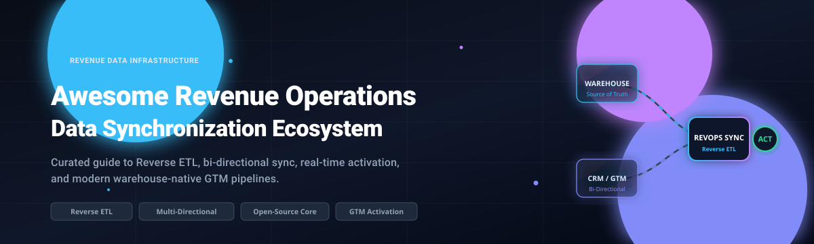

# ⚡ Awesome Revenue Operations Data Synchronization

  
  
  

  <b>A curated catalog of premier Revenue Operations (RevOps) data synchronization platforms, Reverse ETL tooling, multi-directional sync engines, and self-hosted open-source data activation architectures.</b>

---

Revenue Operations (RevOps) and modern data teams rely on continuous data synchronization to turn the cloud data warehouse into an operational source of truth. By orchestrating bidirectional sync and Reverse ETL pipelines across CRMs (Salesforce, HubSpot), ERPs, customer support desks, and marketing automation systems, GTM teams eliminate operational silos and act on real-time customer intelligence.

---

## 📑 Contents

- [📊 Sector Overview & Market Dynamics](#-sector-overview--market-dynamics)
- [☁️ SaaS Platforms](#️-saas-platforms)
- [💻 Open-Source Projects](#-open-source-projects)
- [🏗️ Frameworks & Architectural Paradigms](#️-frameworks--architectural-paradigms)
- [💖 Support](#-support)
- [🤝 How to Contribute](#-how-to-contribute)
- [⚖️ Disclaimer](#️-disclaimer)
- [📈 Star History](#-star-history)

---

## 📊 Sector Overview & Market Dynamics

The global Revenue Operations & data integration market is estimated between **$14.2B and $18.5B**, projected to surpass **$38B–$46B** by 2032 expanding at a 14–17% CAGR driven by warehouse-native data activation, event streaming, and Reverse ETL adoption. The sector remains **moderately fragmented** rather than winner-take-all: enterprise cloud integration giants (MuleSoft, Boomi, Workato) dominate horizontal enterprise connectivity, while specialized Reverse ETL and stateful RevOps sync platforms (Hightouch, Census, Syncari, HubSpot Operations Hub) capture modern GTM and warehouse-centric sync workloads.

---

## ☁️ SaaS Platforms

Commercial cloud platforms powering Reverse ETL, multi-directional field synchronization, and automated RevOps data quality. Sorted by enterprise scale (market valuation / ARR descending).

| Platform | Category / Primary Focus | Company Size (Valuation / Scale) | Pricing Model & Starting Tier | Free Tier Limits / Trial Terms |
| :--- | :--- | :--- | :--- | :--- |
| **[MuleSoft](https://www.mulesoft.com/)** | Enterprise iPaaS & API-Led Connectivity | ~$280B Salesforce Parent Cap (Acquired for $6.5B) | Annual enterprise subscriptions; starting tiers typically from **$25,000–$50,000/year** | **No free tier**; **30-day free trial** of Anypoint Platform (cloud sandbox with standard connectors and design center) |
| **[HubSpot Operations Hub](https://www.hubspot.com/products/operations)** | Native Bi-Directional CRM Sync & Data Quality | ~$13B+ Market Cap (NYSE: HUBS) | Starter tier starts at **$20/month**; Professional starts at **$800/month** (annual contract) | **Free tier available**: Free CRM tools with two-way data sync for standard properties; **14-day free trial** for Professional |
| **[Boomi](https://boomi.com/)** | Cloud Integration, MDM & Data Synchronization | ~$4B Private Valuation ($500M+ ARR) | Base edition starts at **$2,000/month**; custom enterprise quotes for high connection volumes | **No free tier**; **30-day free trial** with full access to AtomSphere platform and test environment |
| **[Workato](https://www.workato.com/)** | Enterprise Automation & RevOps Orchestration | ~$5.7B Valuation ($250M+ ARR) | Base platform packages start at **$10,000/year** (workspace + recipe consumption tiers) | **No free tier**; **no self-serve free trial** (custom guided proof-of-concept / sandbox on sales qualification) |
| **[Zapier](https://zapier.com/)** | Automated App Integration & Zapier Tables Sync | ~$5B Valuation ($250M+ ARR) | Professional tier starts at **$29.99/month** (billed monthly) or **$19.99/month** (billed annually) | **Free forever tier**: 100 tasks/month, 5 active single-step Zaps, 15-minute update frequency; **14-day free trial** for Professional |
| **[Tray.io](https://tray.ai/)** | Low-Code Automation & Multi-Directional Sync | ~$650M Valuation ($50M+ ARR) | Pro tier starting at **$1,000/month** (annual agreement for workflow and connector bundles) | **No free tier**; **14-day free trial** available for qualified enterprise business accounts |
| **[Hightouch](https://hightouch.com/)** | Warehouse-Native Reverse ETL & Streaming Activation | ~$615M Valuation ($30M+ ARR) | Starter plan starts at **$350/month** (includes up to 5 sync destinations and frequent sync intervals) | **Free tier available**: 1 sync destination forever free with standard scheduling; **14-day free trial** for Starter/Business |
| **[Celigo](https://www.celigo.com/)** | Prebuilt Business Process iPaaS & ERP Integrations | ~$500M Valuation ($100M+ ARR) | Standard edition starts at **$600/month** (annual contract covering core endpoints) | **Free edition available**: Free forever plan with 1 active integration flow; **30-day free trial** for full platform |
| **[Census](https://www.getcensus.com/)** | Reverse ETL & Data Activation (Fivetran Unified) | ~$630M Combined Ecosystem (~$125M Series B) | Core paid tier starts at **$350/month** (billed annually, up to 10 destination destinations) | **Free tier available**: Free forever for 1 sync destination with unlimited sync runs; **14-day free trial** for paid tiers |
| **[Syncari](https://syncari.com/)** | Stateful Multi-Directional Sync & RevOps Data Mesh | ~$150M Valuation ($40M+ funding) | Entry-level packages start at **$2,500/month** (annual contract covering multi-node synchronization) | **No free tier**; **no self-serve free trial** (30-day guided sandbox pilot available for qualified enterprise teams) |

---

## 💻 Open-Source Projects

Self-hosted Reverse ETL platforms, bidirectional data pipelines, data ingestion frameworks, and RevOps intelligence architectures. Sorted by GitHub Stars_Count descending.

| Project | GitHub_Stars | Language / Stack | Primary Focus & Capabilities |
| :--- | :--- | :--- | :--- |
| **[Airbyte](https://github.com/airbytehq/airbyte)** |  | Java / Python / Docker | **Universal open-source ELT data integration engine**. Ingests records from 300+ sources into data warehouses and lakes; deployed alongside Reverse ETL platforms for complete bidirectional revenue data loops. |
| **[Lago](https://github.com/getlago/lago)** |  | Ruby / Go / React | **Open-source metering and usage-based billing platform**. Provides high-scale event tracking, subscription lifecycle management, automated invoicing, and real-time synchronization with payment gateways and GTM systems. |
| **[Polar](https://github.com/polarsource/polar)** |  | Python / FastAPI / React | **Modern billing and merchant platform for developers**. Manages subscription checkouts, digital product licensing, usage meters, custom discounts, and developer payout infrastructure. |
| **[CloudQuery](https://github.com/cloudquery/cloudquery)** |  | Go / CLI / SDK | **High-performance data integration framework**. Syncs APIs, cloud assets, and SaaS databases into PostgreSQL, Snowflake, and BigQuery using a modular, pluggable architecture. |
| **[dlt (data load tool)](https://github.com/dlt-hub/dlt)** |  | Python | **Python-first lightweight data pipeline library**. Automatically infers schemas, handles schema evolution, and loads data from Stripe, HubSpot, and custom APIs into modern warehouses. |
| **[RudderStack Server](https://github.com/rudderlabs/rudder-server)** |  | Go / TypeScript | **Customer Data Platform (CDP) & Reverse ETL engine**. Captures customer event streams and syncs computed customer traits and identity graphs from warehouses back into marketing and CRM tools. |
| **[Meltano](https://github.com/meltano/meltano)** |  | Python / Singer | **CLI-driven declarative data integration framework**. Orchestrates Singer taps and targets with dbt transformations and Reverse ETL destinations using code-centric GitOps workflows. |
| **[Multiwoven](https://github.com/Multiwoven/multiwoven)** |  | Ruby / React / Docker | **Self-hosted open-source Reverse ETL & data activation platform**. Native alternative to Hightouch and Census syncing warehouses (Snowflake, BigQuery, Redshift, Databricks, PostgreSQL) to business destinations (Salesforce, HubSpot, Slack, Klaviyo). |
| **[Grouparoo](https://github.com/grouparoo/grouparoo)** |  | TypeScript / Node.js | **Open-source Reverse ETL platform (acquired by Airbyte)**. Connects databases and data warehouses to cloud tools with UI-driven record mapping, model definitions, and scheduled sync jobs. |
| **[Inspector](https://github.com/getbeton/inspector)** |  | TypeScript / Python | **Open-source revenue intelligence platform**. Connects PostHog product analytics with CRM data to detect buying signals, surface product-qualified leads (PQLs), and trigger real-time routing to sales reps. |
| **[B2B SaaS RevOps Intelligence](https://github.com/farrux05-ai/b2b-saas-revops-intelligence)** |  | SQL / dbt / Python | **Production-grade RevOps intelligence reference stack**. Ingests CRM, billing, and product analytics (PostHog, HubSpot, Stripe) into Snowflake via dlt, models MRR waterfalls and NRR in dbt, and performs Reverse ETL back to HubSpot. |
| **[RevenueOS](https://github.com/unempyd/revenueos)** |  | Python / TypeScript | **Autonomous RevOps agent orchestration framework**. Discovers revenue opportunities across mailboxes, documents, community discussions, and growth metrics to execute approved revenue tasks. |

---

## 🏗️ Frameworks & Architectural Paradigms

When designing high-velocity Revenue Operations data pipelines:

- 🔄 **Self-Hosted Reverse ETL**: [Multiwoven](https://github.com/Multiwoven/multiwoven) provides a standalone UI and orchestrator for warehouse-to-SaaS activation without vendor data leakage.
- 📥 **Lightweight Ingestion to Warehouse**: [dlt](https://github.com/dlt-hub/dlt) and [Airbyte](https://github.com/airbytehq/airbyte) extract raw CRM, payment, and product telemetry into Snowflake/BigQuery with automated schema evolution.
- 🎯 **Signal-Based GTM Activation**: [Inspector](https://github.com/getbeton/inspector) and [B2B SaaS RevOps Intelligence](https://github.com/farrux05-ai/b2b-saas-revops-intelligence) transform transformed warehouse metrics (e.g., PQL scores, churn risk, ARR thresholds) into sales tasks and automated field syncs.
- ⚡ **Multi-Directional & Streaming Differentiators**: While open-source tools excel at scheduled batch Reverse ETL, patented stateful conflict resolution ([Syncari](https://syncari.com/)) and streaming sub-second activation ([Hightouch](https://hightouch.com/)) remain key advantages in enterprise commercial suites.

---

## 💖 Support

Thank you for visiting and using this resource! 🙏

If you found this curated list helpful for evaluating revenue operations and data synchronization architectures, please consider:
- ⭐ **Starring** this repository to help others discover it.
- 🍴 **Forking** the repo and contributing additional tools or updates.
- 📢 **Sharing** this repository with your engineering, finance, and RevOps peers.
- ☕ **Buying a coffee / sponsoring** the project via the [GitHub Sponsors Dashboard](https://github.com/sponsors/ishandutta2007). Your support helps keep this guide active and thoroughly maintained!

---

## 🤝 How to Contribute

Contributions are welcome! To propose new platforms, frameworks, or updates:

1. Fork this repository.
2. Update `README.md` following existing table standards.
3. Include verifiable links, transparent starting tiers, and clear architectural boundaries.
4. Submit a Pull Request with a clear description of your additions.

---

## ⚖️ Disclaimer

- This curated list is maintained for educational and architectural evaluation purposes.
- Revenue operations data synchronization platforms handling customer and revenue data must comply with applicable privacy regulations (GDPR, CCPA) and data security policies; **self-hosted solutions place full responsibility for connector reliability, data quality, and access controls on the operator**.
- All product names, logos, and brands are property of their respective owners.

---

##  Star History

